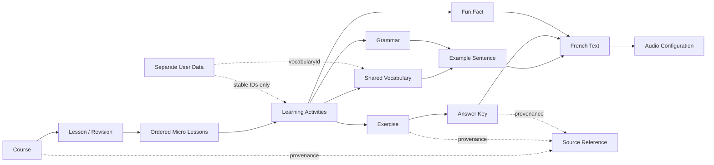

# PHASE 4 — Content and user-data model

日期：2026-10-21（America/New_York）。格式版本 1；内容样本版本 0.4.0-sample。

## 数据关系

## 内容实体与字段责任

| 集合 | 责任 |
|---|---|
| courses | 教材/课程标题及有序 lessonIds |
| lessons | 原章号、原标题、lesson/revision 类型、microLessonIds 和该课词汇角色 |
| microLessons | 目标、activityIds、先修微课引用；顺序保存在 lesson 内 |
| activities | 按 kind 区分词卡、语法、例句、练习、Fun Fact、复习、发现活动；引用内容而非拷贝 |
| vocabulary | 全局 lexicalKey、原形法语引用、英文义、词性、IPA 状态、例句、关联词、助记；名词/动词字段分别约束 |
| frenchTexts | 所有结构化法语片段、发音引用、可核验的词形到 vocabularyId 映射 |
| grammarPoints | Essential / Explanation / Deep Dive 分层英文说明及法语/例句引用 |
| exampleSentences | 法语引用、必需英文翻译；翻译可有不同来源标记 |
| exercises | 原章/练习/题号、原题内容、题型、答案 ID、提示、评分方式、所属 lesson |
| answerKeys | 反向 exerciseId、相同原题身份、参考答案、可接受形式、可选新增解析 |
| funFacts | language/culture/memory 类别、法语、英文说明及其独立来源、关联词和可选互动题 |
| audioAssets | fr-FR TTS（正常/慢速）或本地 audio/ 文件；只描述资源，不实现播放系统 |
| sources / sourceReferences | PDF 哈希/页数、1-based 物理页、可空印刷页、可选 bbox 和定位说明 |
| coverage | sample/complete 声明与独立原书题目清单，用于识别遗漏 |

原书来源记录用 `textbook`，新增解释/练习/趣味知识分别为 `additional-explanation`、`extra-practice`、`additional-fun-fact`。所有实体保留 reviewStatus。原书英文答案与新增解释分别标记，不能因同卡展示而混为一类。

## ID 与复用

实体 ID 全局唯一、稳定、与展示顺序解耦。词汇通过 lexicalKey 去重，例如 `finir|verb|general`；一词可以被多课以不同角色引用，但只存在一个 vocabularyId。同形异义或不同词性用显式词义身份区分，不依靠字符串粗暴合并。先规范 NFC/大小写后检测重复 lexicalKey，原始拼写不被改写。

词汇角色为 core/supporting/optional；Previously Learned 是用户学习记录与词汇 ID 的关系，不作为固定教材属性。只改词条内容不改 ID 即可更新各课；重新排列 microLessonIds 不生成新活动身份。Original Order 是原题身份的查询视图，不复制活动和练习。

原题 exerciseNumber 保存来源编号形式；查询与身份比较仅归一化点号/连字符/中点，显示不静默改号。复习的 R 前缀保留。答案同题身份必须匹配，不能仅靠数组下标对应。

## 用户数据分离

`src/user-data/schema.ts` 单独定义 lessonProgress、activityProgress、vocabularyProgress、reviewHistory、exerciseAttempts、bookmarks、preferences，引用内容 ID，不拷贝教材。内容 schema 使用严格对象，混入用户记录会报错；用户 schema 也拒绝课程包。

当前只定义格式与类型，未实现 IndexedDB、导入恢复、迁移、调度、掌握度计算。显示答案与自评分开存字段；词汇掌握、语法步骤、练习完成分开。未知/被移除的旧 ID 应在 PHASE 9 迁移时保留待处理，不能因新内容里查不到而清空记录。本阶段没有写入或删除任何学习记录。

## 法语、翻译与发音

结构化法语不嵌在任意 UI 文本里，而使用 frenchTextId；所有 FrenchText 必须双向关联 AudioAsset。例句必须有英文翻译。辅助英文讲解里提及的法语需要作为 frenchTextIds 提供可定位片段，作者审查仍负责避免遗漏。自动工具不能可靠识别任意英文字符串中偷偷夹入的法语。

IPA 为 pending + null + reason，或 verified + value + reference + verifiedBy + verifiedAt。不能填写未经核验的值并标记已验证；字段齐全也不等于音标语言学正确，仍需要独立审核。

发音配置完整性不是音频质量证明，本地文件存在性及实际播放/跨浏览器支持留 PHASE 6。可疑词形保持 needs-review，不能向学习者呈现为可靠分析。

## 版本与公开范围

schemaVersion 负责格式兼容；contentVersion 负责内容修订。当前仅接受 schemaVersion 1，不识别的版本明确拒绝，不尝试破坏性迁移。当前装载单文件上限 5 MiB；后续按章节拆包时需在不改变实体 ID 的前提下设计跨包引用，不声称现已实现跨包装载。

`content/private/lesson8-sample.json` 被 Git 忽略，不进公开仓库或 Pages。公开测试只用明确标记的合成测试数据。旧 `src/data/prototype.json` 是 PHASE 3 私人界面样本，与 v1 格式不兼容；继续保留用于 UI 审查，不能冒充正式内容库。原型的新增教学文案已集中到 prototype-copy.ts；新增正式内容必须走 ContentBundle。没有将 17 个微课或全书提前转换。
